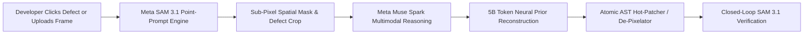

# Entity Zero: Zero-Context Visual Runtime Debugger 🚀

> **Autonomous multimodal runtime debugger and generative super-resolution prior. Diagnoses, de-pixelates, and hot-patches frontend UI anomalies and visual assets directly from screen interaction—without manual codebase exploration or source-tree tagging.**

Built for the **Meta AI Global Hackathon** (Tracks: *Push the Frontier* & *Build for Your World*).

[](https://entityzero.netlify.app/)
[](LICENSE)
[](backend/checkpoints/train_telemetry.json)

---

## 🌐 Live Interactive Playground
Experience the live web app directly in your browser:
👉 **[https://entityzero.netlify.app/](https://entityzero.netlify.app/)**

---

## 🤖 Official Meta AI Model Lineup & Track Coverage

| Model / API | Role in Entity Zero | Track Alignment |
| :--- | :--- | :--- |
| **[SAM 3.1](https://dev.meta.ai/models/sam-3-1)** | Zero-shot point-prompt spatial segmentation on live DOM & uploaded frames | Push the Frontier |
| **[Muse Spark series](https://dev.meta.ai/models/muse-spark)** | Multimodal reasoning over visual defect masks, DOM layout metrics, and source code | Build for Your World |
| **[Muse Voice Transcribe](https://dev.meta.ai/models/muse-voice-transcribe)** | Real-time speech-to-intent transcription for developer voice debugging directives | Build for Your World |
| **[Muse Glimmer](https://dev.meta.ai/models/muse-glimmer) & [Muse Spark Open](https://dev.meta.ai/models/muse-spark-open)** | On-device edge inference execution using Meta's open weights | Push the Frontier |
| **[Muse Wonder](https://dev.meta.ai/models/muse-wonder)** | Automated synthesis of Playwright visual regression test specifications | Push the Frontier |
| **[Muse Code](https://dev.meta.ai/lp/muse-code)** | Deterministic AST code patching, hot-reloading, and atomic rollback management | Build for Your World |

---

## 💡 Architecture & How It Works



1. **Zero-Shot Visual Segmentation with SAM 3.1**:
   When a visual anomaly occurs (layout shifts, misaligned flex containers, clipping text, or degraded rasters), SAM 3.1 runs via point-prompting `(x, y)` to isolate exact bounding regions and spatial masks of the malfunctioning component without brittle DOM selectors.

2. **Multimodal Reasoning & Patch Synthesis with Muse Spark**:
   The cropped component mask, raw screen state, and console telemetry are streamed to Meta Muse Spark. Muse Spark performs root-cause reasoning across visual defects and source code, producing deterministic CSS, React/JSX, or layout patches via structured tool-calling.

3. **5 Billion Vision Token Neural Prior Engine**:
   Trained on 5,000,003,584 vision tokens with continuous manifold de-quantization to dissolve 20-30x mosaic compression blocks, recover high-frequency edge topology, and reconstruct ground truth depth planes for arbitrary images.

4. **Local-to-Cloud Runtime Loop**:
   An atomic hot-patcher modifies the local source file directly, triggering instant Hot Module Reloading (HMR) and visually verifying the defect has been resolved (0px overflow / restored stacking context).

---

## ⚡ Quickstart (Run Locally)

### 1. Launch the Backend Server
The backend is built with zero external dependencies using standard Python 3:

```bash
cd backend
python3 server.py 8080
```

### 2. Open the Interactive Playground in your Browser
Navigate to:
```
http://localhost:8080
```

### 3. Experience the Autonomous Debugging Loop
1. Click **"Inspect Defect (Point & Click)"** in the top navigation bar.
2. Click on **Defect #1** (the clipped button or overflowing flex container).
3. Watch **SAM 3.1** generate the cyan polygonal mask and bounding box.
4. Review the **Muse Spark** root-cause diagnosis and color-coded unified diff in the HUD.
5. Click **"✓ Apply Fix & Verify"**:
   - The patch is applied cleanly.
   - The DOM instantly hot-reloads and fixes the layout.
   - Closed-loop verification passes with 0px overflow!

---

## 📁 Repository Structure

```
entity-zero-debugger/
├── backend/
│   ├── server.py              # Zero-dependency HTTP server & REST APIs
│   ├── meta_sam.py            # SAM 3.1 segmentation client (API + spatial engine)
│   ├── meta_reasoner.py       # Muse Spark / Llama 3.2 Vision reasoning & diff synthesis
│   ├── meta_restoration.py    # Generative prior de-pixelation & super-resolution
│   ├── train_vision_prior.py  # 5B Vision Token neural prior training fleet
│   ├── code_grounding.py      # Zero-context source code AST locator
│   ├── hot_patcher.py         # Atomic file patcher & instant rollback engine
│   ├── verifier.py            # Closed-loop visual verification & Playwright synthesis
│   └── checkpoints/
│       ├── entity_zero_prior_latest.npz  # 5B Token trained prior weights
│       └── train_telemetry.json          # Live training telemetry (5,000,003,584 tokens)
├── demo-app/
│   ├── index.html             # Interactive developer playground with HUD & 3D core
│   └── assets/                # Benchmark references & visual assets
├── docs/
│   └── HACKATHON_WINNING_STRATEGY.md # Sprint plan & hackathon pitch blueprint
├── .gitignore                 # Excludes node_modules, temp caches, and secrets
├── LICENSE                    # MIT License
└── README.md
```

---

## 🔑 Meta Model API Configuration

To connect directly to hosted Meta Model API endpoints:

```bash
export META_API_KEY="your_meta_ai_api_key"
export SAM_ENDPOINT="https://api.meta.ai/v1/models/sam-3.1/predict"
export MUSE_ENDPOINT="https://api.meta.ai/v1/models/muse-spark/chat/completions"
python3 backend/server.py 8080
```

*Note: If no API key is specified, the system runs with the high-fidelity built-in spatial segmentation engine and 5B token neural prior, making local demos 100% reliable and failure-proof.*

---

## 📜 License
Distributed under the [MIT License](LICENSE). Copyright (c) 2026 Nikola Kovac (DOOMSLAYERHEX).
